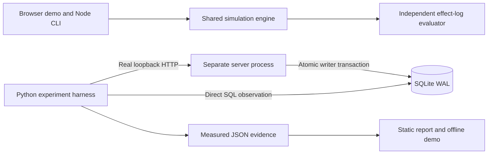

# ActionProof: proving an effect before claiming success

## The engineering problem

A tool call can acknowledge input dispatch without establishing application success. After a timeout, the client does not know whether the server committed. Retrying can duplicate the effect; observing a pre-existing “Success” label can produce a false claim; noticing a changed target after a click cannot undo the wrong write.

This project develops a problem encountered in [my upstream browser-postcondition contribution](https://github.com/OrchestratorInc/agent-orchestrator/pull/4783). The lab is an independent prototype, not that upstream implementation.

## Architecture

The simulation explains policy tradeoffs. The real adapter tests the underlying storage/transport mechanism. Their outputs are labeled separately; neither is presented as an LLM benchmark.

## Decisions that matter

**Bind the command, not just a key.** The idempotency record stores a canonical command fingerprint. Reusing a key with a different operation or expected target returns 409 rather than silently applying another intent.

**Place the guard at the commit boundary.** The target check, effect insertion, and receipt binding share `BEGIN IMMEDIATE` and one SQLite commit. A pre-dispatch client snapshot alone cannot protect against drift.

**Treat ambiguity as a state.** The simulated policy preserves unknown outcomes when evidence is unavailable and a key's retention guarantee has expired. A refusal is not scored as completing the task. The SQLite adapter retains its keys indefinitely; it does not claim to implement expiry.

**Evaluate something independent.** The real harness reads the effect table with direct SQL. A 200 response or a convincing receipt string does not, by itself, pass the invariant check.

**Make the controls fail visibly.** An unkeyed retry after an actual disconnect commits twice. An unguarded action after target drift writes the wrong invoice. Reproducing these controls is an expected experiment result, not a safe completion.

## Reproducible evidence

The real corpus checks eight cases: clean commit, keyed and unkeyed disconnect retries, process exit after commit and restart, 20 simultaneous same-key clients, conflicting key payloads, and guarded/unguarded target drift. The emitted report records durable effect counts, receipt identity, status counts, runtime versions, and the tested source commit where available.

For the restart case, the server calls `os._exit(86)` after `Store.approve()` commits but before a response. A different server process opens the same database; lookup and retry must retain the original receipt. For concurrency, twenty HTTP clients start together; exactly one response must create the effect and the other nineteen must replay it.

See the current CI run and the deployed report for observed results. The report is written only after all specified checks succeed. Browser QA also verifies that the measured evidence can be viewed and downloaded independently of simulation exports.

## Limits and interview claim

This demonstrates idempotent effects for one SQLite database under explicit local failure conditions. It does not prove universal exactly-once delivery, replica failover, power-loss durability, or production agent performance. All records are synthetic and no external system is called.

An accurate summary is: “I built a fault-injection lab that separates agent success claims from durable effects, then tested its protocol mechanisms over real HTTP with SQLite persistence, process crashes, and concurrent clients.”
